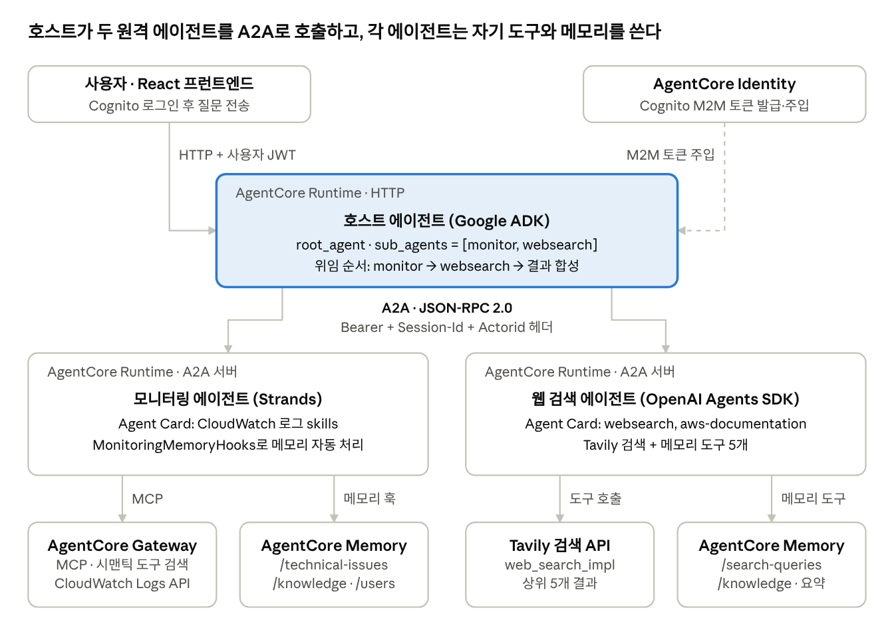

# A2A 멀티 에이전트 인시던트 대응 — 강의 노트

2026-10-11 · moonju.khim@gmail.com

## 강의 개요

이 노트는 01-MultiAgent.pptx(46장)의 이론을 01.A2A-multi-agent-incident-response 샘플 하나로 증명하며 강의하기 위한 자료입니다. 샘플은 Google ADK 호스트 에이전트가 Strands 모니터링 에이전트와 OpenAI Agents SDK 웹 검색 에이전트를 A2A로 호출하는 구조이며, 세 에이전트가 각각 별도의 AgentCore Runtime에서 동작합니다.

**학습 목표(슬라이드 2, 45)**

1. 다중 에이전트 아키텍처가 필요한 시나리오를 분석한다 → 샘플의 '모니터링 vs 해결책 검색' 도메인 분리
2. 주요 통신 패턴과 사용 사례를 설명한다 → 호스트(ADK sub_agents) + 원격(A2A 서버)
3. 도구로서의 에이전트 패턴을 프로덕션용으로 구성한다 → AgentCore Runtime, Gateway, Identity
4. 플랫폼 기능으로 메모리 공유를 구현한다 → AgentCore Memory, session_id/actor_id 전파

**권장 시간 배분(약 100분 기준, 조정 가능)**

| 파트 | 슬라이드 | 시간 | 샘플 연결 |
| --- | --- | --- | --- |
| 1. 단일 에이전트의 한계와 다중 에이전트의 이점 | 3–13 | 20분 | 인시던트 대응을 하나의 에이전트로 만들면 생기는 문제 |
| 2. 다중 에이전트 통신 패턴 | 14–25 | 35분 | 아키텍처, Agent Card, A2A 호출, 인증 + 데모 |
| 3. 메모리 및 상태 관리 | 26–39 | 30분 | memory_hook.py, memory_tool.py, 헤더 전파 |
| 지식 확인 · 요약 · Q&A | 40–46 | 15분 | 퀴즈 2의 정답을 샘플 코드로 확인 |

**사전 준비**: us-west-2 배포 완료(`uv run deploy.py`, 약 10–15분), Bedrock 모델 액세스, Tavily API 키, 프런트엔드(`npm run dev`) 또는 `test/connect_agent.py`로 시연 가능 상태 확인. 강의 후 `uv run cleanup.py`로 정리합니다.

## 슬라이드별 강의 노트

각 항목은 '핵심 메시지 → 말할 포인트 → 샘플 연결' 순서입니다. 샘플 연결이 없는 슬라이드는 슬라이드 노트대로 진행하고 넘어갑니다.

### 도입 (슬라이드 1–2)

- **슬라이드 2 어젠다**: "오늘은 이론 3파트를 하나의 실제 샘플로 끝까지 따라갑니다"라고 예고합니다. 데모 GIF(`images/demo.gif`)를 30초 보여주며 "오늘 끝날 때 이 화면 뒤에서 무슨 일이 일어나는지 설명할 수 있게 됩니다"로 동기를 부여합니다.

### 파트 1. 단일 에이전트의 한계와 다중 에이전트의 이점 (슬라이드 3–13)

- **슬라이드 4 단일 에이전트의 문제점**: 제약은 인지 부하, 컨텍스트 윈도우 고갈, 도메인 전문화 세 가지입니다. 질문으로 시작하세요: "장애 대응 에이전트 하나에 CloudWatch 도구, 웹 검색, JIRA를 모두 붙이면 어떤 일이 생길까요?"
- **슬라이드 5 인지 부하**: 서로 다른 도메인 로직이 섞이고 혼동이 연쇄됩니다. 샘플 연결: "지금 지표를 읽는 일"과 "웹에서 해결책을 찾는 일"은 판단 기준이 다릅니다. 모니터링 프롬프트의 "현재 상태는 항상 새 조회로 확인하라"는 규칙과 웹 검색의 "일반적인 해결책"을 한 프롬프트에 넣으면 서로 간섭합니다.
- **슬라이드 6 컨텍스트 윈도우 고갈**: 노트의 200K 토큰 사례(25K → 155K, 응답 2초 → 15초)를 그대로 설명합니다. 샘플 연결: 로그 이벤트 원문과 검색 결과 본문은 토큰을 많이 씁니다. 하위 에이전트가 각자 자기 컨텍스트에서 원문을 처리하고 호스트에는 요약(아티팩트)만 돌려주므로 호스트 컨텍스트가 보호됩니다.
- **슬라이드 7 도메인 전문화**: 전문화와 일반화는 단일 에이전트에서 양자택일하고, 오케스트레이터가 둘을 결합합니다. 샘플 연결: 슬라이드의 고객 서비스 그림을 "호스트(오케스트레이터) + 모니터링(전문가) + 웹 검색(전문가)"로 치환해 보여주세요.
- **슬라이드 8 이점 개요**: 재사용성, 격리, 유지 관리성, 확장성, 내결함성, 복원력은 마이크로서비스의 이점과 같습니다. "이 샘플은 에이전트 3개가 런타임 3개, 컨테이너 이미지 3개, CloudFormation 스택 3개로 나뉘어 있다"는 사실로 마이크로서비스 유비를 구체화합니다.
- **슬라이드 9 구성 요소 재사용성**: 공유 에이전트 풀에는 표준화된 계약이 필요합니다. 샘플 연결: 모니터링 에이전트는 A2A 서버이므로 호스트가 아닌 다른 팀의 에이전트(예: 비용 분석 에이전트)도 Agent Card URL과 토큰만 있으면 그대로 재사용할 수 있습니다.
- **슬라이드 10 격리와 유지 관리성**: 에이전트별 파이프라인이 따로 있습니다. 샘플 연결: 각 에이전트 스택은 자기 ECR, CodeBuild, Runtime을 갖습니다. 프레임워크도 다릅니다(ADK / Strands / OpenAI Agents SDK). "버전이나 프레임워크가 달라도 충돌하지 않는다"가 실제로 성립하는 예입니다.
- **슬라이드 11 확장성과 성능**: 독립 스케일링, 병렬 처리, 비용 최적화가 핵심입니다. AgentCore Runtime은 세션 단위로 자동 확장합니다. 보충 포인트: 이 샘플은 세 에이전트가 모두 Sonnet 4.5를 씁니다. 하위 에이전트를 소형 모델로 바꾸는 것이 '비용 최적화된 인프라'의 구체적 예시가 됩니다.
- **슬라이드 12 내결함성과 복원력**: 이중화, 점진적 성능 저하, 회로 차단기, 복구 패턴을 다룹니다. 샘플 연결(반대 사례로 활용): 현재 코드에는 A2A 호출 재시도·백오프가 없고, `InMemoryTaskStore`와 `InMemorySessionService`는 재시작하면 상태가 사라집니다. "웹 검색 에이전트가 죽으면 호스트는 어떻게 해야 할까요?"라고 물어 점진적 성능 저하(지표만 보여주고 해결책은 생략)를 설계하게 합니다.
- **슬라이드 13 결정 기준**: 다섯 가지 질문을 샘플에 대입하는 연습을 합니다. 예상 답: 심층 전문성(예, 지표 vs 해결책), 정교한 조정(예, 순서 있는 위임), 재사용(예, 모니터링), 독립 스케일링(부분적), 가용성(장애 대응 도구라 중요).

### 파트 2. 다중 에이전트 통신 패턴 (슬라이드 14–25)

- **슬라이드 15 세 가지 패턴**: 프레임워크 계층 → 도구로서의 에이전트 → 에이전트 간(A2A) 순으로 복잡성과 유연성이 커집니다. 핵심 멘트: "이 샘플은 패턴을 섞어 씁니다. 호스트 안에서는 ADK가 하위 에이전트를 고르고(프레임워크 계층·위임), 런타임 사이는 A2A로 통신합니다." 슬라이드 노트의 "대다수 시스템은 여러 패턴을 사용한다"의 실제 예입니다.
- **슬라이드 16 프레임워크 계층**: 같은 런타임 안에서 플랫폼이 조정합니다. 샘플 연결: 호스트의 `Agent(sub_agents=[monitor_agent, websearch_agent])`에서 ADK Runner가 세션 상태와 이벤트 흐름을 관리합니다.
- **슬라이드 17 도구로서의 에이전트**: 오케스트레이터가 전문가를 호출하고 결과를 합성합니다. 샘플 연결: 호스트 프롬프트의 '위임 규칙 + 오케스트레이션 전략(1. monitor → 2. websearch → 3. 합성)'을 화면에 띄우세요. "도구 설명(description)이 곧 라우팅 기준"이라는 점을 강조합니다.
- **슬라이드 18 에이전트 간(A2A)**: 이 강의의 중심 슬라이드입니다. 용어 다섯 개를 샘플 코드에 하나씩 매핑합니다. A2A 클라이언트 = 호스트의 `RemoteA2aAgent`, A2A 서버 = `A2AStarletteApplication`, 에이전트 카드 = `AgentCard(...)` + `/.well-known/agent-card.json`, 태스크 = `new_task()` + `TaskUpdater`, 아티팩트 = `updater.add_artifact(..., name="agent_response")`. 여기서 데모와 코드 워크스루(아래 섹션)로 넘어갑니다.
- **슬라이드 19–22 Strands 패턴(워크플로, 그래프, 스웜)**: 샘플에는 없는 패턴입니다. 비교 질문으로 연결하세요: "호스트의 'monitor 먼저, 그다음 websearch'는 프롬프트로 강제한 순서입니다. 이걸 결정적으로 보장하려면 어떤 패턴이 맞을까요?" 예상 답: 그래프 또는 워크플로. 사고 대응에 여러 전문가가 자율적으로 넘겨주며 협업한다면 스웜(슬라이드 19 노트의 '다분야 사고 대응' 예시)입니다.
- **슬라이드 23 상태 유지**: 시스템 프롬프트, 과거 상호 작용, 에이전트 상태, 사용자 자격 증명을 다룹니다. 샘플 연결: A2A 태스크 상태(`submitted → working → completed`)가 '에이전트의 상태'의 예이고, M2M 토큰이 '자격 증명'의 예입니다.
- **슬라이드 24 통신 표준(인터페이스 계약)**: 입출력 형식, 오류 처리, 스키마, 인증을 계약으로 정의합니다. 샘플 연결: Agent Card의 `defaultInputModes/defaultOutputModes`(입출력), `skills`(기능), `version`(버전), JSON-RPC 2.0 오류(`InvalidParamsError`, `InternalError`). 빠진 것도 짚어 주세요: 카드에 `securitySchemes`(인증 요구 사항) 선언이 없습니다.
- **슬라이드 25 보안 영향**: A2A는 중앙 통제를 우회하므로 보안이 가장 복잡합니다. 샘플 연결: 런타임마다 Cognito JWT 인증(`CustomJWTAuthorizer` + `AllowedClients`), 에이전트별 M2M 클라이언트, AgentCore Identity의 `@requires_access_token`. 토론 거리: actor ID를 검증된 JWT가 아니라 요청 헤더에서 받으므로 헤더만 바꾸면 다른 사용자의 메모리에 접근할 수 있습니다(`host_adk_agent/main.py:31`).

### 파트 3. 메모리 및 상태 관리 (슬라이드 26–39)

- **슬라이드 27 메모리 복습**: 컨텍스트 인텔리전스, 사용자 선호, 지식 보존입니다. 샘플 매핑: 모니터링 메모리의 네임스페이스 세 개가 정확히 대응합니다. `/technical-issues/{actorId}`(사고·지표 사실), `/knowledge/{actorId}`(일반 지식), `/users/{actorId}`(사용자 선호).
- **슬라이드 28 다중 에이전트의 메모리 문제**: 컨텍스트 단편화와 동기화가 문제입니다. 샘플은 호스트의 session_id와 actor_id를 A2A 헤더로 하위 에이전트에 전파해서, 각자 다른 메모리를 쓰면서도 같은 대화 단위로 묶습니다.
- **슬라이드 29 세 가지 접근**: AgentCore Memory, Strands SDK, 외부 스토리지가 있습니다. 샘플은 두 하위 에이전트 모두 AgentCore Memory를 씁니다. 호스트는 ADK `InMemorySessionService`만 씁니다.
- **슬라이드 30 AgentCore Memory 개요**: 단기(원시 이벤트) → 전략(추출) → 장기(레코드)로 이어집니다. 샘플 연결: `create_event()`가 단기, `retrieve_memories()`가 장기입니다. 이벤트 만료는 `EventExpiryDuration: 60`(일)입니다.
- **슬라이드 31 다중 에이전트용 Memory**: 세션 격리, 에이전트 간 공유, 프레임워크 무관을 다룹니다. 샘플이 '프레임워크 무관'을 증명합니다. Strands는 훅(`HookProvider`)으로, OpenAI Agents SDK는 도구(`@function_tool`)로 같은 Memory API를 씁니다.
- **슬라이드 32–33 공유 메모리 예와 코드**: 슬라이드는 메모리 훅과 `create_memory_session(actor_id, session_id)` 패턴을 보여줍니다. 샘플의 `MonitoringMemoryHooks`가 같은 구조의 확장판(단기 + 장기)이므로 나란히 띄워 비교합니다. 차이점도 설명하세요. 슬라이드는 memory_id 하나를 공유하지만, 샘플은 에이전트별로 Memory 리소스가 따로 있습니다.
- **슬라이드 34 공유 기법**: 선호, 목표, 상태, 컨텍스트를 공유하고 전체 기록 대신 요약을 넘깁니다. 샘플에서 호스트가 받는 것은 하위 에이전트의 아티팩트(요약된 결과)뿐입니다.
- **슬라이드 35–36 invocation_state와 ToolContext**: Strands 그래프·스웜에서는 같은 프로세스 안의 상태를 `invocation_state`로 넘깁니다. 대비 포인트: 런타임이 다른 A2A에서는 같은 역할을 HTTP 헤더(`X-Amzn-Bedrock-AgentCore-Runtime-Session-Id`, `...-Custom-Actorid`)가 합니다.
- **슬라이드 37 외부 스토리지**: CRM, 의료, 금융이 사례입니다. 샘플 확장 아이디어: 사고 티켓을 JIRA나 ITSM에 기록하는 것이 여기에 해당합니다.
- **슬라이드 38 구현 권장 사항**: 관찰성을 처음부터 구현하라는 내용입니다. 샘플은 런타임마다 로그 전송(Logs Delivery)과 OTEL 계측(`OpenAIAgentsInstrumentor`)이 들어 있습니다. CloudWatch GenAI Observability 화면에서 트레이스를 보여주면 좋습니다.
- **슬라이드 39 살펴보기**: Sofia 고객 시나리오를 샘플 버전으로 바꿔 설명할 수도 있습니다. 1일 차에 "EC2 CPU가 높다"고 질문하면 커스텀 전략이 `/technical-issues/{actorId}`에 사고 사실을 추출합니다. 3일 차에 "지난번 그 문제 재발했어?"라고 물으면 메모리 훅이 그 기록을 찾아 `<memory-context>`로 주입합니다.

### 지식 확인과 요약 (슬라이드 40–46)

- **문제 1(정답 B, 인지 부하)**: "우리 샘플에서는 지표 해석과 해결책 검색이 섞이는 것이 같은 증상"이라고 연결합니다.
- **문제 2(정답 D, memory_id + 공유 session_id + 고유 actor_id)**: 샘플에서는 세 값이 각각 어디서 오는지 보여주세요. memory_id는 `MEMORY_ID` 환경변수, session_id와 actor_id는 A2A 요청 헤더입니다(`agent_executor.py`의 `execute()`).
- **슬라이드 45 요약**: 네 가지 목표를 강의 개요의 매핑으로 다시 확인합니다.

## 샘플 아키텍처 워크스루

에이전트 3개가 각각 독립된 AgentCore Runtime에서 돌고, 호스트만 사용자와 만납니다. 슬라이드 18을 설명할 때 이 그림을 옆에 두고 용어를 하나씩 짚으세요.



요청은 위에서 아래로 흐릅니다. 사용자 JWT로 호스트에 들어오고, 호스트는 Identity가 주입한 M2M 토큰으로 두 A2A 서버를 호출하며, 각 서버는 자기 도구와 메모리만 씁니다.

| 구성 요소 | 폴더 | 프레임워크 | 역할 | 관련 슬라이드 |
| --- | --- | --- | --- | --- |
| 호스트 에이전트 | `host_adk_agent/` | Google ADK + LiteLLM | A2A 클라이언트, 위임과 결과 합성 | 7, 15–17 |
| 모니터링 에이전트 | `monitoring_strands_agent/` | Strands Agents | A2A 서버, CloudWatch 로그 조회(Gateway 경유) | 18, 32–33 |
| 웹 검색 에이전트 | `web_search_openai_agents/` | OpenAI Agents SDK + LiteLLM | A2A 서버, Tavily로 해결책 검색 | 18, 31 |
| 인증 | `cloudformation/cognito.yaml` | Cognito + AgentCore Identity | 사용자 JWT, 에이전트별 M2M 클라이언트 | 25 |
| 프런트엔드 | `frontend/` | React + Vite | 호스트 런타임 호출, 도구 사용 과정 표시 | 데모 |

모델은 세 에이전트 모두 `global.anthropic.claude-sonnet-4-5-20250929-v1:0`(Bedrock)이며 배포 시 바꿀 수 있습니다.

## 코드 핵심 포인트

슬라이드 18의 용어 순서대로 코드 다섯 군데를 보여주면 A2A 전체 흐름이 설명됩니다. 각 발췌는 실제 코드를 줄인 것입니다.

### ① 에이전트 카드 — "나는 누구이고 무엇을 할 수 있는가" (슬라이드 18, 24)

`web_search_openai_agents/main.py`

```python
agent_card = AgentCard(
    name="WebSearch Agent",
    url=runtime_url,                      # AGENTCORE_RUNTIME_URL
    version="0.3.0",
    defaultInputModes=["text/plain"],
    defaultOutputModes=["text/plain"],
    capabilities=AgentCapabilities(streaming=True, pushNotifications=False),
    skills=[AgentSkill(id="websearch", name="Web Search",
                       examples=["Search for solutions to RDS connection timeout issues"], ...)],
)
server = A2AStarletteApplication(agent_card=agent_card, http_handler=request_handler)
```

- 말할 포인트: 카드는 `/.well-known/agent-card.json`으로 자동 게시됩니다. 클라이언트는 이 카드만 읽고 상대의 프레임워크(OpenAI Agents SDK)를 몰라도 호출합니다.
- 비교: 모니터링 에이전트 카드의 skills는 Gateway 도구명(`monitoragenta2aTarget___FilterLogEvents` 등)을 그대로 노출합니다. "카드의 기술 수준을 어느 정도로 해야 하나"는 슬라이드 17의 '인터페이스 설계 균형' 토론거리입니다.

### ② A2A 서버를 AgentCore Runtime에 올리기 (슬라이드 18)

`cloudformation/monitoring_agent.yaml`

```yaml
Type: AWS::BedrockAgentCore::Runtime
ProtocolConfiguration: A2A          # 호스트는 HTTP
NetworkConfiguration: { NetworkMode: PUBLIC }
AuthorizerConfiguration:
  CustomJWTAuthorizer:
    DiscoveryUrl: <Cognito DiscoveryUrl>
    AllowedClients: [<모니터링용 M2M 클라이언트>]
```

- 말할 포인트: 코드는 포트 9000에 뜨는 평범한 Starlette 앱입니다. `ProtocolConfiguration: A2A` 한 줄이 런타임을 A2A 서버로 만듭니다. 호스트는 프런트엔드가 부르는 일반 HTTP 런타임(`BedrockAgentCoreApp` + `@app.entrypoint`)입니다.
- 호출 URL 형식: `https://bedrock-agentcore.{region}.amazonaws.com/runtimes/{URL 인코딩된 ARN}/invocations/`

### ③ A2A 클라이언트 — 호스트가 원격 에이전트를 도구처럼 쓰기 (슬라이드 15–17)

`host_adk_agent/agent.py`

```python
monitor_agent = RemoteA2aAgent(
    name="monitor_agent",
    description="Agent that handles monitoring tasks.",
    agent_card=f".../runtimes/{quote(MONITOR_AGENT_ARN, safe='')}/invocations/.well-known/agent-card.json",
    a2a_client_factory=_create_client_factory(provider_name=MONITOR_PROVIDER_NAME,
                                              session_id=session_id, actor_id=actor_id),
)
root_agent = Agent(model=LiteLlm(model=f"bedrock/{MODEL_ID}"),
                   instruction=SYSTEM_PROMPT,
                   sub_agents=[monitor_agent, websearch_agent])
```

- 말할 포인트: 원격 에이전트도 로컬 하위 에이전트와 같은 자리(`sub_agents`)에 들어갑니다. 로컬과 원격이 같은 추상화라는 점이 A2A의 가치입니다.
- 라우팅은 LLM이 `description`과 호스트 `SYSTEM_PROMPT`의 위임 규칙을 보고 결정합니다.
- 상세히 들어가지 않아도 되는 부분: `LazyClientFactory`는 이벤트 루프마다 새 httpx 클라이언트를 만드는 우회 코드입니다. "런타임과 ADK 이벤트 루프 사이의 기술적 호환 코드"라고만 소개합니다.

### ④ 인증 — AgentCore Identity가 M2M 토큰을 발급 (슬라이드 25)

```python
@requires_access_token(provider_name=provider_name, scopes=[],
                       auth_flow="M2M", into="bearer_token", force_authentication=True)
def _create_client(bearer_token: str = str()) -> httpx.AsyncClient:
    headers = {
        "Authorization": f"Bearer {bearer_token}",
        "X-Amzn-Bedrock-AgentCore-Runtime-Session-Id": session_id,
        "X-Amzn-Bedrock-AgentCore-Runtime-Custom-Actorid": actor_id,
    }
```

- 말할 포인트: 코드에 client secret이 없습니다. 자격 증명 공급자 이름(SSM에 저장)만으로 AgentCore Identity가 Cognito에서 토큰을 받아 주입합니다.
- 하위 에이전트는 받은 workload 토큰으로 다시 Gateway용 토큰을 받습니다(`get_resource_oauth2_token`, `monitoring_strands_agent/utils.py`). 인바운드와 아웃바운드 인증이 연쇄되는 구조입니다.
- 세션 헤더와 액터 헤더가 여기서 붙습니다. 이것이 파트 3 메모리로 이어지는 연결 고리입니다.

### ⑤ 태스크와 아티팩트 — A2A 서버 쪽 실행기 (슬라이드 18, 23)

`monitoring_strands_agent/agent_executor.py`

```python
session_id = headers.get("x-amzn-bedrock-agentcore-runtime-session-id")
actor_id   = headers.get("x-amzn-bedrock-agentcore-runtime-custom-actorid")
workload_token = headers.get("x-amzn-bedrock-agentcore-runtime-workload-accesstoken")

task = context.current_task or new_task(context.message)
updater = TaskUpdater(event_queue, task.id, task.context_id)
await updater.update_status(TaskState.working, new_agent_text_message(accumulated_text, ...))
await updater.add_artifact([Part(root=TextPart(text=accumulated_text))], name="agent_response")
await updater.complete()
```

- 말할 포인트: 태스크는 고유 ID와 수명 주기를 갖고(working → completed), 최종 출력은 아티팩트로 분리됩니다. `cancel()`도 구현돼 있어 태스크 취소가 가능합니다.
- 두 원격 에이전트의 실행기 구조가 거의 같습니다. A2A SDK가 프레임워크 차이를 `AgentExecutor` 뒤로 숨깁니다.

### ⑥ 메모리 훅 — 프레임워크별 메모리 연결 (슬라이드 30–33)

`monitoring_strands_agent/memory_hook.py`

```python
registry.add_callback(AgentInitializedEvent, self.on_agent_initialized)      # get_last_k_turns(k=5) → <recent-conversation>
registry.add_callback(MessageAddedEvent,   self.retrieve_monitoring_context) # retrieve_memories() → <memory-context>
registry.add_callback(AfterInvocationEvent, self.save_monitoring_interaction) # create_event(USER, ASSISTANT)
```

| 항목 | 모니터링(Strands) | 웹 검색(OpenAI Agents SDK) |
| --- | --- | --- |
| 연결 방식 | 훅(자동, 에이전트가 모름) | `@function_tool` 도구(LLM이 호출 여부 결정) |
| 단기 메모리 | `create_event`, `get_last_k_turns` | `save_interaction_to_memory`, `get_recent_conversation_history` |
| 장기 네임스페이스 | `/technical-issues/`, `/knowledge/`, `/users/` | `/search-queries/`, `/knowledge/`, 요약 |
| 장기 전략 | Custom + Semantic + UserPreference | Custom + Semantic + Summary |

- 말할 포인트: 훅 방식은 항상 같은 동작을 보장하고, 도구 방식은 유연하지만 LLM 판단에 맡깁니다. 사례 토론으로 좋습니다.
- 강사용 주의 사항(질문이 나오면): 훅이 메모리를 시스템 프롬프트에 계속 덧붙이고 지우지 않아 프롬프트가 커집니다(`memory_hook.py:78`, `:152`). 슬라이드 6의 컨텍스트 고갈과 연결되는 개선점입니다.

## 데모 진행 가이드

데모는 슬라이드 18 직후 약 15분입니다. "원격 에이전트 단독 → 카드 → 호스트 연결 → 메모리" 순서로 부품부터 전체로 쌓아 올립니다. 배포는 강의 전날 끝내 두세요.

**시연 순서**

1. **원격 에이전트 단독 호출** (슬라이드 9 재사용성): `uv run test/connect_agent.py --agent monitor` → "최근 1시간 동안 Lambda 로그 그룹에서 ERROR를 찾아줘". 호스트 없이도 A2A 서버가 혼자 동작한다는 점을 보여줍니다.
2. **에이전트 카드 확인** (슬라이드 18, 24): A2A Inspector에 카드 URL과 토큰(`uv run web_search_openai_agents/scripts/get_m2m_token.py`)을 넣고, 헤더 3개(`Authorization`, Session-Id 32자 이상, Custom-Actorid)를 추가합니다. skills와 examples를 화면으로 보여주고 JSON-RPC 요청과 응답을 그대로 보여줍니다.
3. **호스트를 통한 오케스트레이션** (슬라이드 15–17): 프런트엔드(`cd frontend && npm run dev`)에서 "EC2 CPU가 높아. 현재 상태를 확인하고 해결 방법을 알려줘". 도구 사용 블록에서 monitor_agent → websearch_agent 순서가 보이는지 짚습니다. 첫 응답에 두 에이전트의 카드 정보가 먼저 나오는 것도 설명합니다(`main.py`의 `yield agents_cards`).
4. **단순 질문과 비교**: "CloudWatch 로그 그룹 목록만 보여줘"를 묻고, 프롬프트가 항상 monitor를 먼저 부르게 돼 있어 단순 조회에도 위임이 일어난다는 점을 관찰합니다(슬라이드 19 패턴 선택 토론으로 연결).
5. **메모리 확인** (파트 3 시작 시): 같은 세션에서 "아까 말한 문제 다시 요약해줘". 모니터링 런타임 로그에서 `Saved monitoring interaction to short-term memory`와 `Injected N long-term memories`를 찾아 보여줍니다. 장기 추출은 비동기라 몇 분 뒤에 반영됩니다.
6. **관찰성** (슬라이드 38): CloudWatch 콘솔 → GenAI Observability에서 호스트 → 하위 에이전트 트레이스를 펼쳐 보입니다.

**대체 경로**: 라이브 환경이 안 되면 `images/demo.gif`, `images/inspector.gif`, `images/adk.gif`로 같은 순서를 진행합니다.

**트러블슈팅**

| 증상 | 확인할 것 |
| --- | --- |
| 401/403 | 토큰 만료(M2M 1시간), 호출 클라이언트가 Runtime `AllowedClients`에 있는지 |
| `InvalidParamsError` | Session-Id(32자 이상) 또는 Custom-Actorid 헤더 누락 |
| 모델 호출 실패 | 해당 리전에서 Bedrock 모델 액세스가 켜져 있는지 |
| 첫 응답이 느림 | 콜드스타트(카드 조회, SSM 조회). 데모 직전에 한 번 호출해 두기 |
| 호스트 응답이 한참 뒤에 한꺼번에 옴 | 호스트→하위 구간이 `streaming=False`입니다. 정상 동작입니다 |
| 웹 검색 실패 | Tavily API 키와 사용 한도 |

## 핵심 정리와 예상 Q&A

**마무리 멘트(세 문장)**

1. 단일 에이전트가 인지 부하, 컨텍스트 고갈, 전문화 절충에 부딪히면 에이전트를 나눕니다. 이 샘플은 '지금 상태 확인'과 '해결책 검색'을 나눴습니다.
2. 나눈 에이전트는 패턴을 섞어 연결합니다. 런타임 안에서는 프레임워크 위임, 런타임 사이는 A2A(카드 → 태스크 → 아티팩트), 보안은 JWT + AgentCore Identity입니다.
3. 메모리는 session_id와 actor_id를 끝까지 전파하는 것에서 시작합니다. 그 위에 단기(이벤트)와 장기(전략별 네임스페이스)를 올립니다.

**예상 Q&A**

| 질문 | 답변 요지 |
| --- | --- |
| A2A와 MCP는 무엇이 다른가요? | MCP는 에이전트와 도구를 잇고, A2A는 에이전트와 에이전트를 잇습니다. 이 샘플은 둘 다 씁니다. 모니터링 → Gateway(CloudWatch 도구)는 MCP, 호스트 → 모니터링은 A2A입니다. |
| 하나의 런타임에 에이전트 3개를 넣으면 안 되나요? | 됩니다(프레임워크 계층 패턴, 슬라이드 16). 대신 독립 배포, 독립 스케일링, 다른 팀의 재사용, 프레임워크 혼용을 포기합니다. |
| 왜 프레임워크를 세 개나 썼나요? | 실제 조직에서는 팀마다 다른 프레임워크를 씁니다. A2A가 그 차이를 흡수한다는 것을 보여주기 위한 설계입니다. |
| 다른 조직의 에이전트도 붙일 수 있나요? | 아웃바운드는 AgentCore Identity에 파트너용 OAuth2 공급자를 등록하고 `RemoteA2aAgent`를 하나 더 추가합니다. 인바운드는 파트너 전용 App Client 또는 토큰 교환입니다. 자세한 내용은 프로젝트의 `외부_에이전트_인증_인가.md`에 있습니다. |
| 에이전트들이 같은 메모리를 공유하나요? | 아닙니다. 두 하위 에이전트는 Memory 리소스가 각각 따로 있고, 같은 session_id/actor_id로 대화 단위만 맞춥니다. 슬라이드 32처럼 memory_id 하나를 공유하도록 바꿀 수 있습니다. |
| actor_id를 헤더로 받아도 안전한가요? | 아닙니다. 헤더를 바꾸면 다른 사용자의 메모리에 접근할 수 있습니다. 검증된 JWT의 `sub` 클레임에서 가져와야 합니다. |
| 하위 에이전트가 죽으면 어떻게 되나요? | 현재는 재시도나 부분 응답 로직이 없습니다. 슬라이드 12의 회로 차단기와 점진적 성능 저하를 호스트에 넣는 것이 개선 과제입니다. |
| 비용을 줄이려면? | 하위 에이전트와 메모리 추출에 소형 모델을 쓰고, 프롬프트 캐싱을 적용하고, 단순 질문에는 하위 에이전트 하나만 부르게 라우팅을 조건부로 바꿉니다. |

개선점 전체 목록은 프로젝트의 `보완.md`(Well-Architected Generative AI Lens 기준)에 정리돼 있습니다. 심화반이나 실습 과제로 활용할 수 있습니다.
